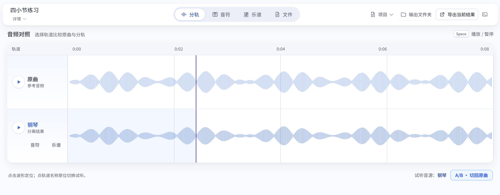
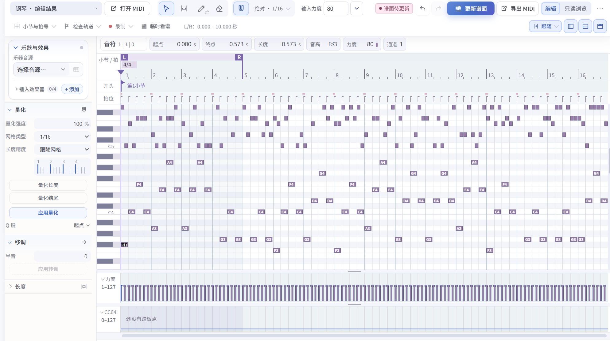
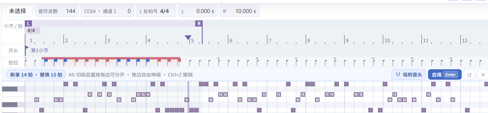
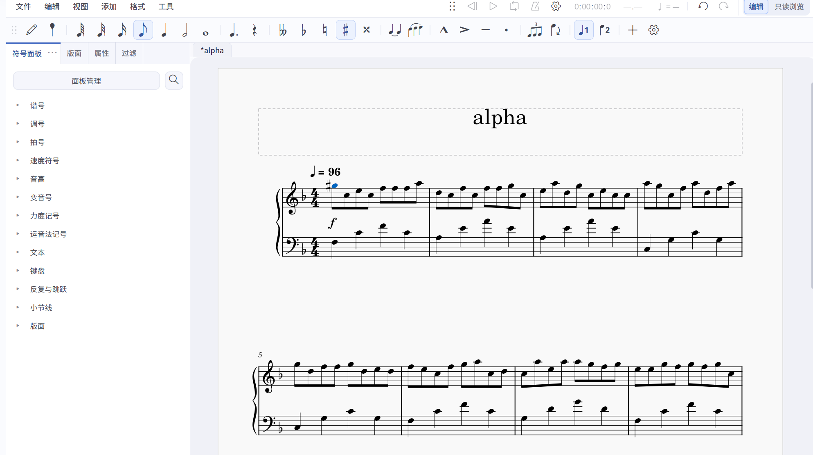

# Astra Studio｜钢琴扒谱与乐谱编辑

Astra Studio 是一个在本机运行的扒谱与编辑工具。它把音频分轨、钢琴 MIDI 转录、拍点与小节编辑、谱面预览与出版连接在同一个工作台里。

这个仓库是 **正式版 4 对应的源码快照**，不是双击即用的 Windows 安装包。首次检出不会带用户工程、录音、模型权重、Python 环境、驱动、VST 插件或已编译程序。无须登录即可读代码、运行源码检查和无模型的 MIDI 命令。

## 为什么做 Astra Studio

我想要的是一个能把音频变成**尽可能准确、而且还能继续改的钢琴谱**的工具。分轨、音频转 MIDI、MIDI 转谱和五线谱编辑，已经各有不错的工具。现在正是把它们接成一套顺手流程的时候：导入录音，生成初稿，再把真正不准的地方修好，不用在几个软件之间反复倒文件。

自动生成不可能每次都对。为了好改，我自己设计了一套**拍点与节拍编辑**：可以跟着原曲手动录拍，调整拍点、小节和拍号，改完就预览对应段落的新谱，不必先更新整首，也不用盲改。确认后再更新主谱，还能在五线谱上继续微调。

## 实测速度与征集改进

我借助大模型和相关研究，针对分轨、转录和制谱的推理流程做了优化，包括复用重复计算和加快模型推理。本机实测（RTX 5070 Ti Laptop 12 GB），**约 5 分钟的曲目，从导入音频、钢琴分轨、转 MIDI 到生成并导出乐谱，全流程约 3 分半**。这是单钢琴路线的实测，耗时会随曲目、硬件和冷启动状态变化。

欢迎拿一段自己真正想扒的钢琴曲来试。如果你有更好的分轨、节奏校正、制谱或推理提速方案，也欢迎在 [Issues](https://github.com/weixuyang0719-source/astra-studio/issues) 分享思路、可复现的例子或对比结果。尤其想听听：**哪一步还可以更快，哪类段落还可以写得更准、更好读？**

## 使用截图

以下是 Windows 版运行示例，使用演示工程。

**首页：** 导入音频或 MIDI、选择任务和输出格式，左侧导航和项目入口都保留。

**分轨试听：** 在同一位置切换原曲与提取的钢琴轨，听分离效果。

**钢琴卷帘：** 在同一页查看并编辑音符、拍点、力度和踏板，左侧可调量化和乐器。

**手动录拍：** 跟着音乐打拍，预览并调整要替换的拍点，再确认写入。

**乐谱编辑：** 在五线谱上修改音符、声部和记号。

## 借物表 · 第三方项目与模型

感谢下列项目和模型的作者。这里列的是钢琴扒谱工作流中直接用到的组件；完整许可、版本与分发范围见 [第三方许可与可选资源](docs/THIRD-PARTY.md)。

| 项目 / 模型 | 在 Astra Studio 里做什么 |
| --- | --- |
| [Audio Separator](https://github.com/nomadkaraoke/python-audio-separator) | 运行音频分轨模型 |
| [X-LANCE 钢琴分轨](https://huggingface.co/chenxie95/xlance-msr-ckpt) | 从混音中提取钢琴，使用 `bs_keys_xlancer.ckpt` |
| [BS-RoFormer-SW](https://github.com/nomadkaraoke/python-audio-separator/blob/main/audio_separator/models.json) | 可选的吉他分轨，使用 `BS-Roformer-SW.ckpt`；链接为模型目录，不是权重授权 |
| [Transkun 2.0](https://github.com/Yujia-Yan/Transkun) | 将钢琴音频转成演奏 MIDI |
| [DuET](https://huggingface.co/Wayne42/DuET) | 将钢琴演奏 MIDI 转成可编辑的乐谱 |
| [MuseScore Studio](https://github.com/musescore/MuseScore/releases/tag/v4.6.5) | 乐谱排版、显示与编辑引擎 |

本仓库不分发上述模型权重。模型代码的许可证不一定适用于权重，获取前请核对对应条款。

## 从源码开始

环境：Windows x64、Python 3.10–3.12。编译原生组件另需 Visual Studio C++ 工具、CMake 和 Windows SDK。请在 PowerShell 中运行：

    py -3.10 -m venv .venv
    .\.venv\Scripts\python.exe -m pip install -e .
    .\.venv\Scripts\python.exe -m astra --help
    .\.venv\Scripts\python.exe scripts\run_source.py --check

安装命令通过 Python 的包管理器获取公共依赖，不会安装模型或 ASIO 驱动。若只是查看 CLI 的帮助或检查 MIDI，可使用已安装依赖的解释器并将 src 放入 PYTHONPATH。

原生音频/VST、录拍 C++ 内核、MuseScore 谱面引擎和分轨/转录模型各有独立前置条件，详见 [构建与验证](docs/BUILD-WINDOWS.md)。准备相应部件后，使用源码启动器运行：

    .\.venv\Scripts\python.exe scripts\run_source.py

它默认使用独立的开发数据目录，不会接管正式版的工程。自带乐谱引擎需要另行构建和接入；未接入时不要把源码模式当作正式版完整体验。

## 项目结构

| 路径 | 内容 |
| --- | --- |
| src/astra/ | 正式版 4 所选 Python 应用代码与两套界面 |
| native/ | 编辑器、音频、VST 及谱面相关的原生源码和构建脚本 |
| native/score-worker/ | MuseScore 4.6.5 的 Astra 精确差异与独立构建配置 |
| provenance/ | 参考版本和已核对的源代码摘要；不包含用户数据 |
| docs/ | 构建、第三方依赖、功能边界和验证记录 |

## 许可证

Astra Studio 原创软件采用 GPL-3.0-only。参见 [LICENSE](LICENSE) 与 [LICENSE-SCOPE.md](LICENSE-SCOPE.md)。第三方源码、字体和依赖各自遵循其授权；具体说明见 [第三方许可与可选资源](docs/THIRD-PARTY.md)。
